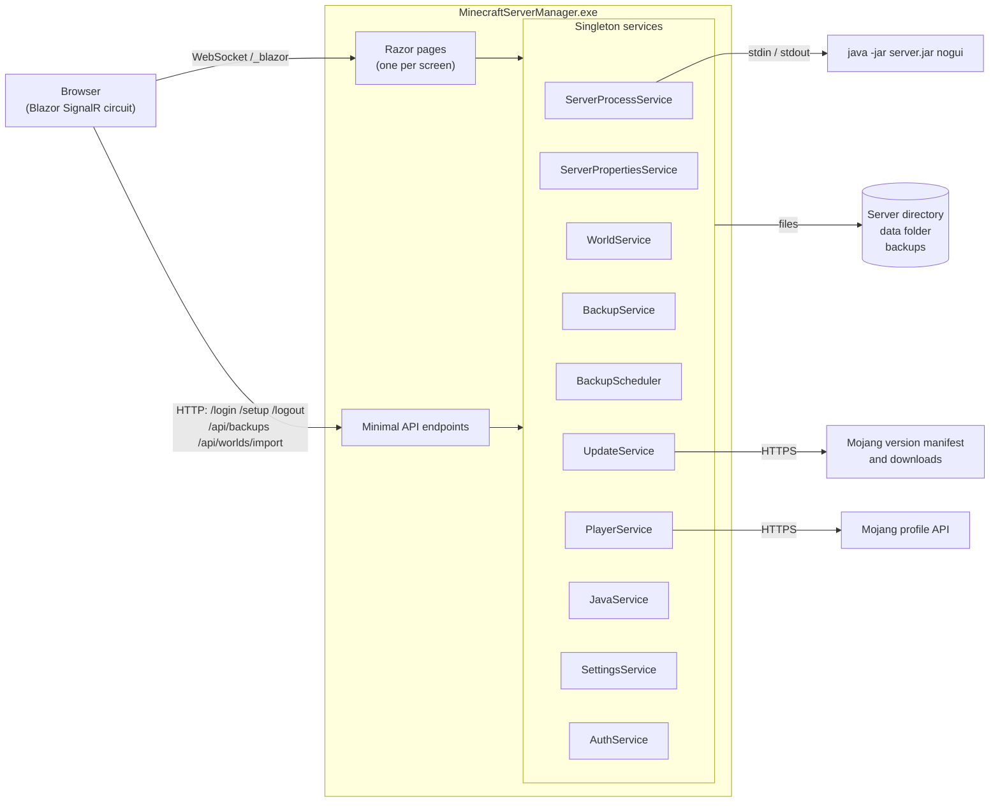
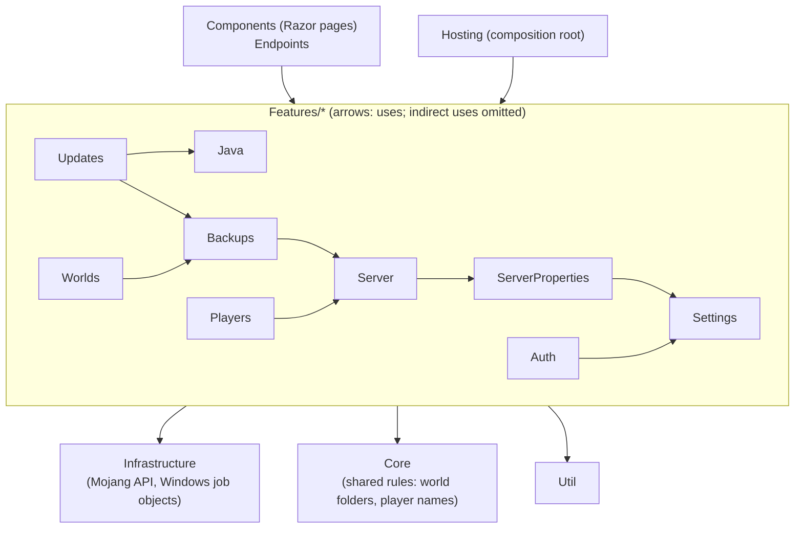
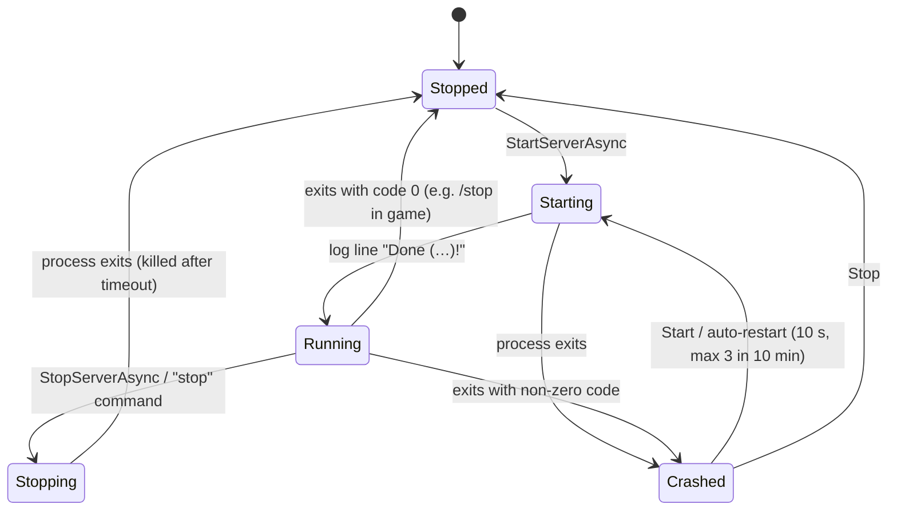
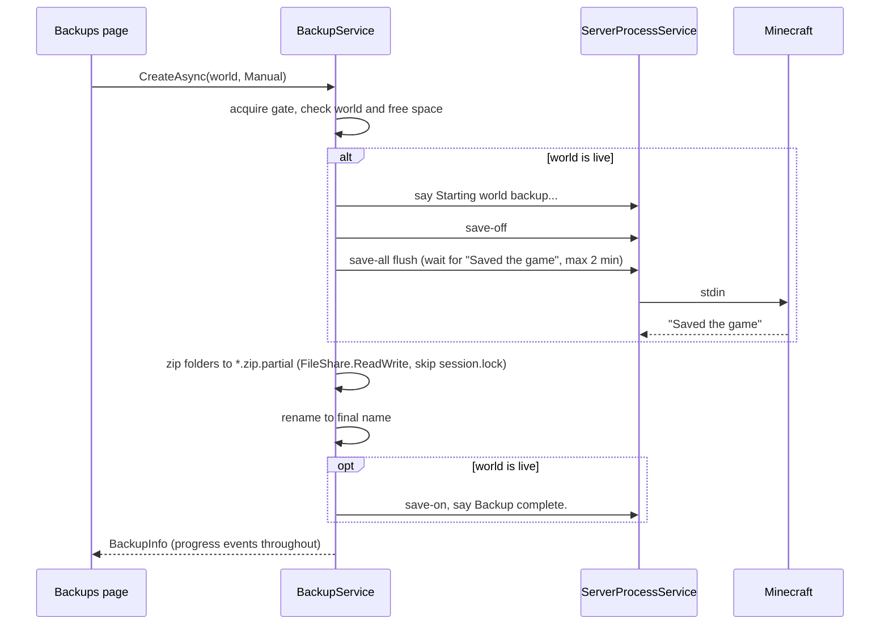

# Architecture

This page describes how Minecraft Server Manager is built, for developers maintaining or extending it.

## Technology

| Layer | Choice |
| --- | --- |
| Runtime | .NET 10, published self-contained and single-file for `win-x64` |
| Web | ASP.NET Core with **Blazor** using **interactive server rendering** (UI runs on the server; the browser holds a SignalR/WebSocket connection) |
| Hosting | Kestrel; `Microsoft.Extensions.Hosting.WindowsServices` for the Windows service lifetime and Event Log |
| Auth | Cookie authentication with a single admin account |
| Storage | Plain files: JSON settings, Java `.properties`, zip backups. No database. |
| Front end | Hand-written CSS (theme tokens, light/dark) and a few lines of JavaScript (`wwwroot/app.js`). No UI framework. |

## Component overview



## Layers

The code is one project (one self-contained executable), organised by feature, with dependencies that only point one way:



- **Features** own the behaviour and state of one area each (server process, worlds, backups and so on). A feature may use a feature *below* it, never one above it, so there are no cycles.
- **Core** holds rules used by more than one feature. **Infrastructure** talks to the outside world (Mojang's HTTP APIs, Win32). **Util** holds small technical helpers. None of these depend on features.
- **Components** render and orchestrate. Business rules, validation and anything that changes the server live in a feature service, where they can be tested without a browser.
- `ArchitectureTests` in the test project enforces these rules by reading the compiled code, including method bodies, so a violation fails the build's tests.

## Services

All services are **singletons** registered in `Hosting/ServiceRegistration.cs`; UI components inject them and subscribe to their events.

| Service | Responsibility |
| --- | --- |
| `SettingsService` | Loads/saves `data/settings.json`. `Current` is an immutable snapshot; changes go through `Update(mutate)`, which clones, applies, writes atomically and swaps. Validates and saves the launch settings. Raises `Changed`. |
| `AuthService` | PBKDF2 hashing, credential checks, per-IP lockout, setup and password change, and the *security stamp* claim that invalidates cookies when credentials change. |
| `ServerPropertiesService` | Reads/writes `server.properties` and `eula.txt` through `JavaPropertiesDocument` (a `java.util.Properties`-compatible parser/writer that preserves comments and order). Keys the manager uses itself are in `ServerPropertyKeys`. |
| `ServerProcessService` | Owns the Java process: start/stop/restart/kill, stdin commands, stdout/stderr pumping and CPU/memory sampling. It delegates to `ConsoleBuffer` (3,000-line ring buffer), `ServerLogParser` (startup, join, leave and `list` lines), `OnlinePlayerList` and `CrashRestartPolicy` (at most 3 automatic restarts in 10 minutes). |
| `ServerLifetimeService` | `IHostedService` that auto-starts the server with the host and stops it cleanly on shutdown. |
| `JavaService` | Runs `java -version` (cached for a minute) and searches standard locations for runtimes. |
| `WorldService` | Lists worlds (reading `level.dat` with a small NBT reader), creates/switches/deletes/imports worlds. |
| `BackupService` | Creates zip backups (with `save-off`/`save-all flush`/`save-on` for the live world), restores with rollback, applies retention, exposes progress. A semaphore ensures one backup/restore at a time. |
| `BackupScheduler` | `BackgroundService` that checks every minute whether a scheduled backup is due. |
| `UpdateService` | Caches Mojang's manifest, resolves server downloads and Java requirements, swaps and archives jars, and rolls back. |
| `PlayerService` | Ops, whitelist (including switching it on and off) and bans, via console commands (running) or JSON files (stopped), with Mojang/offline UUID resolution. |
| `MojangClient` | Infrastructure: Mojang's version manifest, per-version downloads (streamed, SHA-1 verified) and profile lookups. |
| `ToastService` | UI (`Components/Shared`): **scoped**, one notification queue per browser circuit. |

## Server process lifecycle



Key points:

- **Start** validates the directory, jar and EULA, builds the command line (`-Xms`, `-Xmx`, `-Dstdout.encoding=UTF-8`, extra JVM args, `-jar`, jar, server args) and starts Java with redirected streams (UTF-8, no BOM on stdin).
- **Output** is read line by line on background tasks. Each line is ANSI-stripped, appended to the ring buffer, and raised as `LineReceived`. Regular expressions detect `Done`, `joined the game`, `left the game`, and `list` output.
- **Stop** sends `stop`, waits for exit up to `StopTimeoutSeconds`, then kills the process tree. A `SemaphoreSlim` serialises start/stop/restart.
- **Exit handling** classifies the exit: intentional stop, clean exit, or crash (non-zero code, or exit while starting). Crash auto-restart only applies to servers that had reached *Running*.
- **Windows job object.** The Java process is assigned to a job with `JOB_OBJECT_LIMIT_KILL_ON_JOB_CLOSE`, so if the panel process dies, Windows terminates Minecraft too, rather than leaving it orphaned with the world locked and no way to send it commands.
- **Shutdown.** As an `IHostedService`, `StopAsync` stops Minecraft cleanly when the host shuts down. `HostOptions.ShutdownTimeout` is 90 s.

## Live UI updates

Services raise plain .NET events (`StateChanged`, `PlayersChanged`, `StatsUpdated`, `LineReceived`, `Changed`). Components subscribe in `OnInitialized`, marshal back with `InvokeAsync(StateHasChanged)`, and unsubscribe in `Dispose`. `EventHelper.Raise` invokes each subscriber in a try/catch so a broken circuit can't affect the publisher.

The Console batches re-renders on a 200 ms timer to cope with bursts of output, and uses `@key` on lines for efficient diffing. The command box is handled in JavaScript (`mcm.attachConsoleInput`): the box is cleared synchronously on Enter and the command is sent with `DotNetObjectReference.invokeMethodAsync`, so fast typing can never merge two commands.

## Backups



**Restore** reads the archive's top-level folders, validates them, stops the server if the live world is affected, optionally takes a *pre-restore* backup, moves the current folders aside (`.restore-old-<timestamp>`), extracts with zip-slip checks, and on success deletes the old folders. On failure it removes the partial extraction and moves the originals back.

## Updates

`UpdateService.InstallAsync`:

1. Resolve `downloads.server` and `javaVersion.majorVersion` from the version's JSON.
2. Probe the configured Java; refuse if it's too old.
3. Stream the download to `server.jar.download`, hashing with `IncrementalHash(SHA1)`; compare with the manifest's SHA-1.
4. Back up the active world (if enabled), stop the server (if running).
5. Move the current jar to `.manager/jars/<version>__<timestamp>.jar` (keep 5), move the new jar into place.
6. Restart the server if it had been running.

Progress is published as an immutable `UpdateProgress` record, which is also how the UI shows the result afterwards. Versions are ordered by `releaseTime`, never by parsing version strings, because Mojang's numbering changed (1.21.x was followed by 26.1).

## Authentication and rendering

- `App.razor` applies `InteractiveServer` globally **except** for pages marked `[ExcludeFromInteractiveRouting]` (`/login`, `/setup`, `/error`). Those are statically server-rendered so they can set the auth cookie with `HttpContext.SignInAsync`.
- `Components/Pages/_Imports.razor` applies `[Authorize]` to every management page. Unauthenticated HTTP requests are redirected to `/login` by the cookie handler; inside a circuit, `AuthorizeRouteView` renders `RedirectToLogin`.
- The cookie carries a `mcm:stamp` claim derived from the username and password hash; `OnValidatePrincipal` rejects cookies whose stamp no longer matches.
- Data Protection keys are persisted to `data/keys` so sign-ins survive restarts.

## Hosting details

- **Content root:** when `appsettings.json` and `wwwroot` sit next to the executable (a published build), the content root is `AppContext.BaseDirectory`. This matters for a Windows service, whose working directory is `System32`.
- `AddWindowsService` is a no-op when not running as a service, so the same executable works interactively.
- **Machine configuration:** `C:\ProgramData\Minecraft Server Manager\appsettings.json` is added after the content-root `appsettings.json`, so installer-written settings survive upgrades. `MinecraftServerManager.exe configure …` (`Hosting/MachineConfiguration.cs`) writes it and exits before the web host is built.
- Static assets are served by `MapStaticAssets` with fingerprinted URLs and pre-compressed variants.

## Source layout

```text
src/MinecraftServerManager/
  Program.cs                       Host, auth, middleware, endpoints
  Features/                        One folder (and namespace) per area:
    Auth/                          AuthService
    Backups/                       BackupService, BackupScheduler
    Java/                          JavaService
    Players/                       PlayerService
    Server/                        ServerProcessService, ServerLifetimeService, ConsoleBuffer,
                                   ServerLogParser, OnlinePlayerList, CrashRestartPolicy
    ServerProperties/              ServerPropertiesService, JavaPropertiesDocument, PropertySchema,
                                   ServerPropertyKeys
    Settings/                      SettingsService, ManagerSettings
    Updates/                       UpdateService
    Worlds/                        WorldService, LevelInfo/NbtReader
  Core/                            Rules shared by features: WorldFolders, PlayerName
  Infrastructure/                  MojangClient (Mojang/), WindowsJobObject
  Endpoints/ManagerEndpoints.cs    /logout, /api/backups/{file}, /api/worlds/import
  Hosting/
    ServiceRegistration.cs         The composition root: every service and its lifetime
    MachineConfiguration.cs        The configure command used by the installers
  Components/
    App.razor, Routes.razor        Root and router (render-mode selection, auth routing)
    Layout/                        MainLayout (sidebar/top bar), AuthLayout, ReconnectModal
    Account/                       Login, Setup, RedirectToLogin
    Pages/                         One component per page
    Shared/                        Icon, StatusPill, ServerControls, ConfirmDialog, Toasts, ToastService, ConsoleStyles
  Util/                            Fmt, CommandLine, FileUtil, EventHelper
  wwwroot/                         app.css, app.js, favicon.svg
tests/MinecraftServerManager.Tests xUnit unit and integration tests
tools/fake-java/                   Java stand-in for development
scripts/                           publish and service scripts
docs/                              This wiki's source and the Word user guide
```
