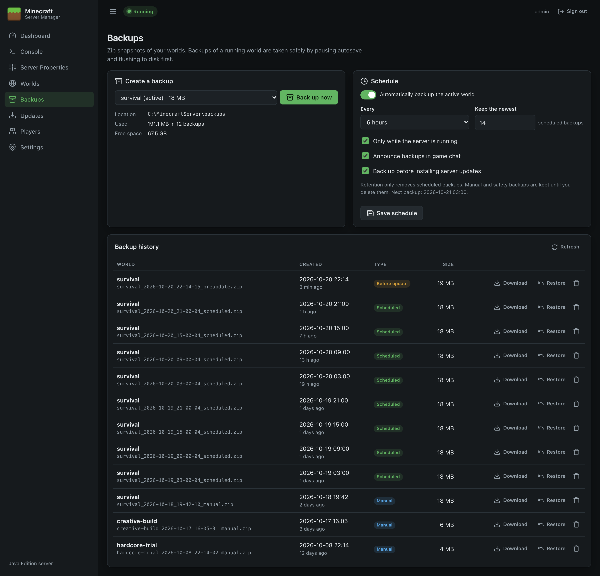
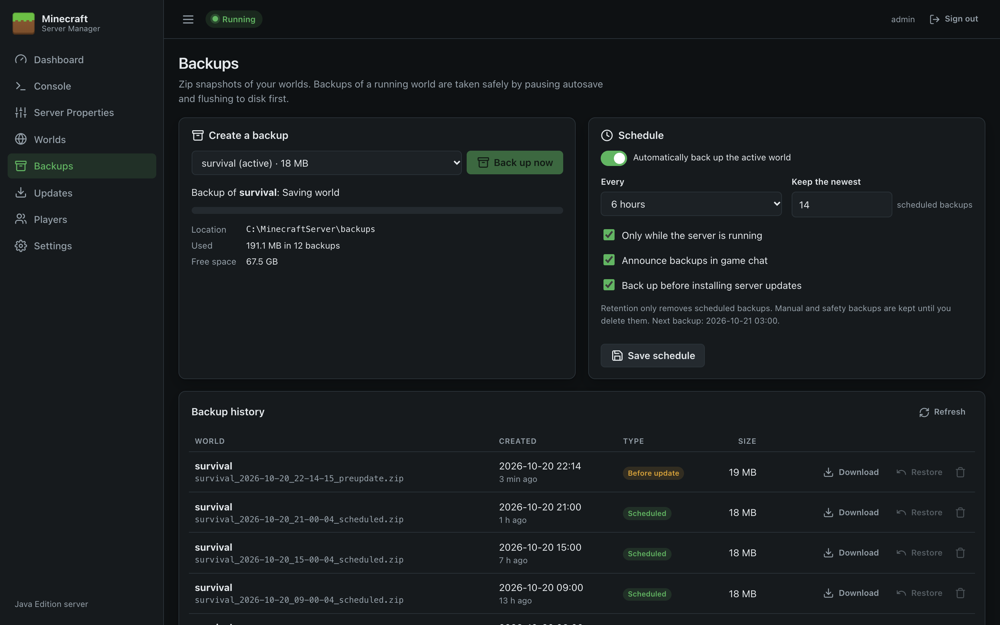
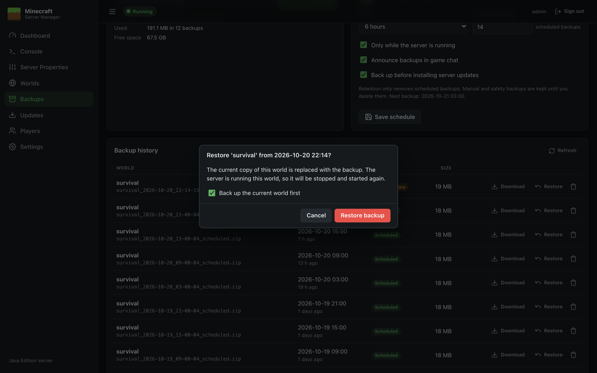

# Backups

The Backups page takes zip backups of your worlds, runs them on a schedule, and lets you restore, download or delete them.

## Taking a backup now

1. Under **Create a backup**, choose the world (the active one is selected by default).
2. Click **Back up now**. A progress bar shows each stage and how much has been copied.

You can also back up from the [Dashboard](Dashboard) (active world) or from any world card on [Worlds](Worlds).

### Backing up a running world safely

Copying a world while Minecraft is writing to it can produce a damaged backup. When the world being backed up is the one the server is running, the panel does this automatically:

1. Announces `Starting world backup...` in chat (if **Announce backups in game chat** is on).
2. Runs `save-off` so Minecraft stops writing to the world files.
3. Runs `save-all flush` and waits (up to 2 minutes) for Minecraft to confirm *Saved the game*.
4. Compresses the world into a zip.
5. Runs `save-on` and announces `Backup complete.` Autosave is turned back on even if the backup fails.

Players can keep playing throughout. Their changes are held in memory and saved once autosave is back on.

> If the server is still **Starting…** or **Stopping…**, the backup is refused with a message. Try again in a moment.

### What's in a backup

- The world folder, plus `<world>_nether` and `<world>_the_end` if they exist (Paper/Spigot layout).
- Not `session.lock`, which Minecraft keeps locked while running and doesn't need restoring.
- Files are stored under the world's folder name inside the zip, e.g. `survival/region/r.0.0.mca`.

Before starting, the panel checks there's enough free space on the backup drive.

## Storage

The **Location**, **Used** and **Free space** lines show where backups are kept and how much room is left. By default backups go in `backups` inside the server directory. You can choose another folder (ideally another drive) in [Settings](Settings#server).

> **Keep a copy somewhere else.** Backups on the same disk don't protect against disk failure. Copy the backup folder to another machine or cloud storage regularly, or download important backups.

## Scheduled backups

| Setting | Meaning |
| --- | --- |
| **Automatically back up the active world** | Turns the schedule on. The first backup runs within a minute of saving. |
| **Every** | 30 minutes, 1, 2, 3, 6 or 12 hours, a day or a week. |
| **Keep the newest … scheduled backups** | Older *scheduled* backups beyond this number are deleted automatically after each scheduled backup. |
| **Only while the server is running** | Skip backups while the server is stopped (the world can't change then). |
| **Announce backups in game chat** | Tell players when a backup starts and finishes. |
| **Back up before installing server updates** | Take a *Before update* backup automatically before [Updates](Updates) replaces the server jar. |

Click **Save schedule** to apply. The time of the next backup is shown under the settings, and on the [Dashboard](Dashboard).

> Retention only removes **scheduled** backups. Manual backups and the automatic safety backups (*Before update*, *Before restore*, *Before delete*) are kept until you delete them.

## Backup history

Every backup is listed, newest first, with the world, date, type, and size.

| Type | Created by |
| --- | --- |
| **Manual** | You, with *Back up now* or a *Back up* button |
| **Scheduled** | The schedule |
| **Before update** | Installing a server version |
| **Before restore** | Restoring a backup, if *Back up the current world first* was ticked |
| **Before delete** | Deleting a world, if *Take a backup first* was ticked |

Actions:

- **Download** saves the zip to your computer.
- **Restore** replaces the world with the backup (see below).
- **🗑** deletes the backup permanently, after confirmation.

## Restoring a backup

1. Click **Restore** on the backup.
2. Leave **Back up the current world first** ticked (recommended) so you can undo the restore.
3. Click **Restore backup**.

What happens:

- If the backup is of the world the server is running, the server is **stopped**, the world restored, and the server **started again**.
- The current world folder is set aside and only deleted once the backup has been fully extracted. If anything goes wrong the original is put back, so a failed restore never leaves you without a world.
- Restoring a world that isn't active doesn't affect the running server. Use **Set active** on [Worlds](Worlds) if you want to play it.

## Backup file names

Backups are named `<world>_<yyyy-MM-dd_HH-mm-ss>_<type>.zip`, for example `survival_2026-10-20_21-00-04_scheduled.zip`. Zips you copy into the backup folder by hand also appear in the list (shown as *Manual*). To restore those, the zip must contain the world folder at its top level.
