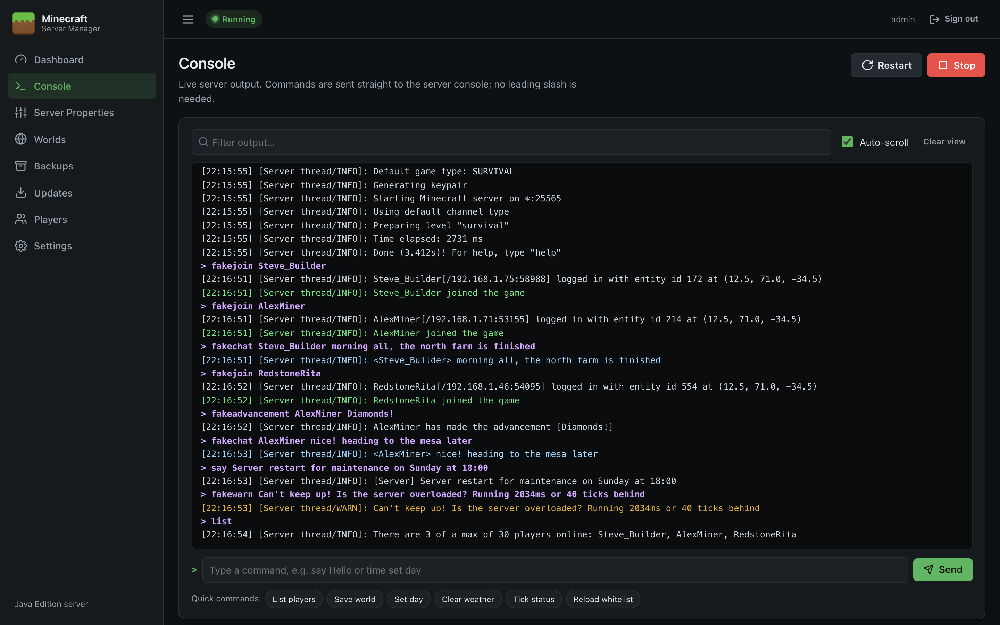
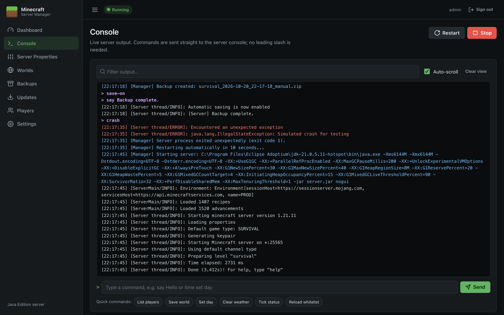

# Console

The Console shows the Minecraft server's output live and lets you run server commands as if you were typing into the server window.

## Reading the output

Lines are coloured so important events stand out:

| Colour | Lines |
| --- | --- |
| White | Normal server messages |
| Yellow | Warnings (`WARN`), e.g. *Can't keep up! Is the server overloaded?* |
| Red | Errors (`ERROR`/`FATAL`) and anything written to the error stream |
| Green | Players joining and leaving |
| Light blue | Player chat |
| Purple (bold) | Commands you or the panel sent, shown as `> command` |
| Blue | Messages from the panel itself, tagged `[Manager]`: start/stop, backups, updates, restarts |

- **Filter output…** shows only lines containing the text you type (not case-sensitive).
- **Auto-scroll** keeps the newest line in view. Untick it to scroll back without being pulled down.
- **Clear view** hides everything currently shown. It doesn't delete anything; it only clears your screen.
- The panel keeps the last **3,000 lines** in memory since it started, and the page shows up to the last 1,000. The server's complete log is always in `logs\latest.log` in the server directory.

## Running commands

Type a command in the box at the bottom and press **Enter** (or click **Send**).

- **No leading slash is needed** (`time set day`, not `/time set day`); a leading slash is removed if you type one.
- The command box is only available while the server is running.
- Press **↑** and **↓** to go back through commands you've sent on this page.
- The response appears in the output like any other line.
- Typing `stop` stops the server cleanly. The panel treats it as an intentional stop, not a crash, so it won't restart automatically.

### Quick commands

The buttons under the command box send common commands with one click (available while the server is **Running**):

| Button | Command | Does |
| --- | --- | --- |
| List players | `list` | Shows who's online and resynchronises the panel's player list |
| Save world | `save-all` | Saves the world to disk now |
| Set day | `time set day` | Sets the time to morning |
| Clear weather | `weather clear` | Stops rain and thunder |
| Tick status | `tick query` | Shows the server's tick rate and performance |
| Reload whitelist | `whitelist reload` | Re-reads `whitelist.json` |

### Useful commands

| Command | Purpose |
| --- | --- |
| `say <message>` | Broadcast a message to everyone as `[Server]` |
| `op <player>` / `deop <player>` | Grant or remove operator status (also on [Players](Players)) |
| `kick <player> [reason]` | Disconnect a player |
| `gamerule <rule> <value>` | Change a game rule, e.g. `gamerule keepInventory true` |
| `difficulty <peaceful\|easy\|normal\|hard>` | Change difficulty until the next restart |
| `tp <player> <x> <y> <z>` | Teleport a player |
| `weather <clear\|rain\|thunder>` | Change the weather |
| `whitelist add <player>` | Add to the whitelist (also on [Players](Players)) |

## After a crash

When the server crashes, the error is shown in red followed by the panel's own messages. If **Restart automatically after a crash** is on (see [Settings](Settings)), the panel restarts the server after 10 seconds, up to 3 times in 10 minutes.

