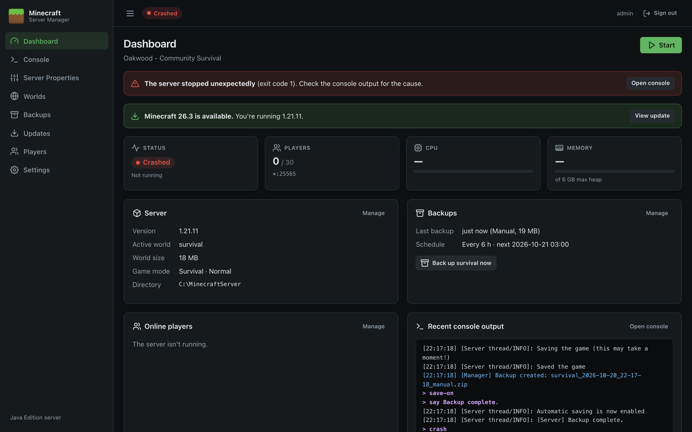

# Dashboard

The Dashboard is the home page. It shows the server's state at a glance and has the main **Start / Stop / Restart** controls.

## Server controls

The buttons at the top right change with the server's state:

| Button | When it appears | What it does |
| --- | --- | --- |
| **Start** | Server stopped or crashed | Launches Java with your [Settings](Settings). Fails with a clear message if there's no server jar, the EULA hasn't been accepted, or Java can't be found. |
| **Restart** | Server running | Stops the server cleanly, then starts it again. |
| **Stop** | Server running | Sends `stop`, waits for the world to save and the process to exit (up to the *Graceful stop timeout*, 60 seconds by default), then kills it if it's still running. |
| **Kill** | While starting or stopping | Ends the Java process immediately, after confirmation. **Anything not yet saved is lost.** Use it only if the server is stuck. |

The same controls are on the [Console](Console) page.

## Alerts

Banners appear at the top when something needs attention:

| Banner | Meaning and action |
| --- | --- |
| **No server installed** | There's no `server.jar` yet. Click **Install server** to go to [Updates](Updates). |
| **Accept the Minecraft EULA** | Mojang requires agreement to the [EULA](https://aka.ms/MinecraftEULA) before the server can run. Click **I agree** if you accept it. |
| **The server stopped unexpectedly** | The server crashed (the exit code is shown). Click **Open console** to see why. See [Troubleshooting](Troubleshooting#the-server-crashes). |
| **Minecraft x.y is available** | A newer release than the one installed exists. Click **View update**. |

## Status cards

| Card | Shows |
| --- | --- |
| **Status** | Current state and how long the server has been up. |
| **Players** | Players online / `max-players`, and the address and port the server listens on (`*` means all network interfaces). |
| **CPU** | The Minecraft process's share of the whole machine's CPU (all cores), updated every 2 seconds. |
| **Memory** | Memory used by the Java process, compared with the maximum heap set in [Settings](Settings#memory-and-jvm). Java reserves memory up front, so a steady high figure is normal. |

## Information panels

- **Server**: installed Minecraft version, the active world (with a *Generated on next start* badge if it doesn't exist yet), world size on disk, game mode and difficulty, and the server directory. **Manage** opens [Updates](Updates).
- **Backups**: when the last backup was taken (and its type and size) and the backup schedule. **Back up *world* now** takes an immediate backup of the active world, with a progress bar. **Manage** opens [Backups](Backups).
- **Online players**: everyone currently connected. **Manage** opens [Players](Players).
- **Recent console output**: the last dozen console lines. **Open console** opens the full [Console](Console).

## Tips

- The player list is built from join/leave messages in the log. Clicking **Refresh** on the [Players](Players) page (which runs `list`) resynchronises it.
- The subtitle under *Dashboard* is the server's MOTD with colour codes removed.
