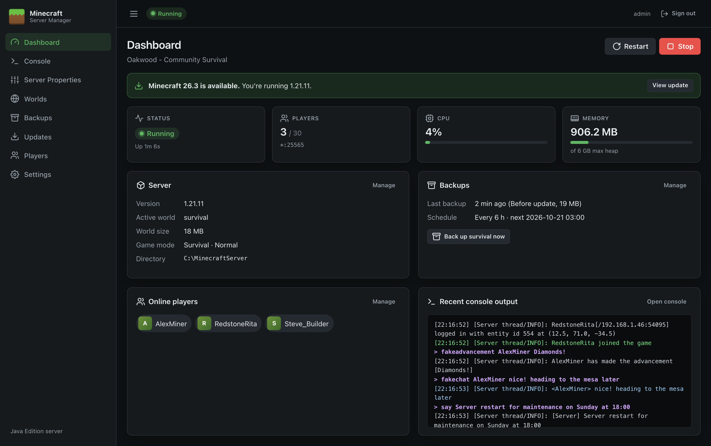

# Minecraft Server Manager

**Minecraft Server Manager** is a web control panel for running a **Minecraft: Java Edition** dedicated server on **Windows Server**. It installs with a setup wizard, runs in the background as a Windows service, and is managed from any web browser.

**[Download the latest release](https://gitea.uk.local:3001/Apps/minecraft-server-management/releases)** (setup wizard, MSI or zip).

## What it does

| | |
| --- | --- |
| **Run the server** | Start, stop and restart with one click. Watch status, players, CPU and memory live. The server restarts itself after a crash and shuts down cleanly with Windows. |
| **Console** | See the live server log, colour-coded, and type commands without logging on to the server. |
| **Configure** | Edit every `server.properties` setting through a form with descriptions and validation. |
| **Worlds** | Generate new worlds (with seeds, world types and superflat presets), switch between worlds, and import singleplayer saves. |
| **Backups** | Take safe backups of a running world, schedule them, and restore or download them. |
| **Updates** | Install or update the official Minecraft server from Mojang, verified and with automatic backup and rollback. |
| **Players** | Manage operators, the whitelist and bans, and kick or ban players who are online. |

## Where to start

- **New here?** Follow the [Quick Start](Quick-Start), then read the [User Guide](User-Guide).
- **Installing for real?** See [Installation](Installation) and [Running as a Windows Service](Running-as-a-Windows-Service).
- **Something not working?** Check [Troubleshooting](Troubleshooting) and the [FAQ](FAQ).
- **Prefer a document?** Download the [User Guide (Word)](raw/Minecraft-Server-Manager-User-Guide.docx).

## Documentation map

**Getting started**
- [Quick Start](Quick-Start): from download to a running server in ten steps
- [Installation](Installation): requirements, the setup wizard and MSI, first-run setup, Java and firewall

**User guide**
- [User Guide](User-Guide): signing in and finding your way around
- [Dashboard](Dashboard) · [Console](Console) · [Server Properties](Server-Properties) · [Worlds](Worlds) · [Backups](Backups) · [Updates](Updates) · [Players](Players) · [Settings](Settings)

**Administration**
- [Running as a Windows Service](Running-as-a-Windows-Service)
- [Remote Access and HTTPS](Remote-Access-and-HTTPS)
- [Configuration Reference](Configuration-Reference)
- [Server Properties Reference](Server-Properties-Reference)
- [Files and Folders](Files-and-Folders)
- [Security](Security)
- [Troubleshooting](Troubleshooting) · [FAQ](FAQ)

**Development**
- [Architecture](Architecture) · [HTTP Endpoints](HTTP-Endpoints) · [Development](Development) · [Release Notes](Release-Notes)

## At a glance

| | |
| --- | --- |
| **Version** | 1.0.1 |
| **Runs on** | Windows Server 2016 or later, Windows 10/11 (x64) |
| **Needs** | Java 21 or later (Java 25 for Minecraft 26.x), and internet access for downloads |
| **Default address** | `http://localhost:8080` |
| **Installs with** | Setup wizard (`.exe`), MSI, or portable zip |
| **Built with** | ASP.NET Core Blazor on .NET 10, published as one self-contained `.exe` |
| **Source** | [Apps/minecraft-server-management](https://gitea.uk.local:3001/Apps/minecraft-server-management) |
