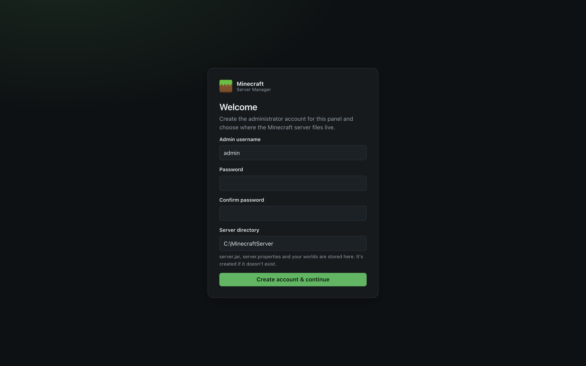
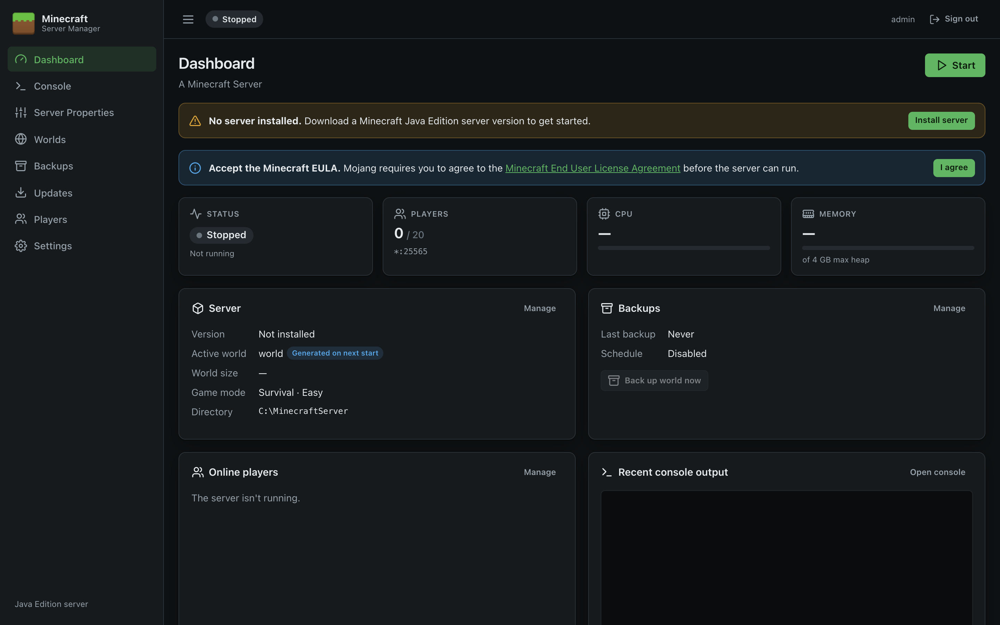
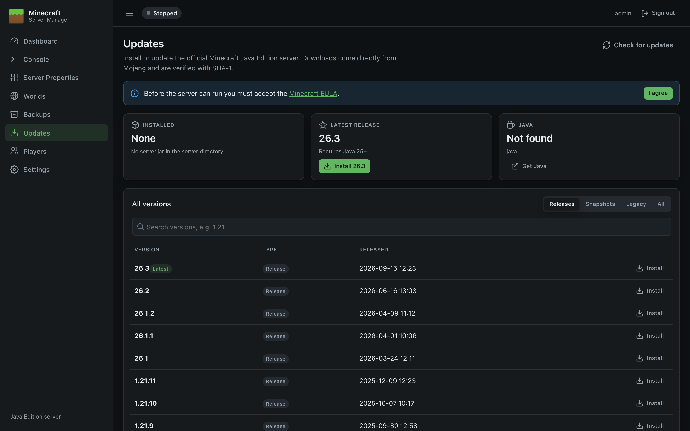

# Installation

This page covers system requirements, installing the panel with the setup wizard, first-run setup, Java, unattended installation, and upgrading or removing the panel.

## Requirements

| Item | Requirement |
| --- | --- |
| Operating system | Windows Server 2016, 2019, 2022 or 2025, or Windows 10/11, 64-bit (x64) |
| .NET | **Not required.** The panel is self-contained. |
| Java | A 64-bit Java runtime matching your Minecraft version (see below) |
| Memory | Enough for Windows plus the Minecraft heap. 8 GB total is a sensible minimum for a small server. |
| Disk | About 120 MB for the panel, plus worlds and backups (allow several GB) |
| Network | Internet access to download Minecraft and check for updates. TCP port **25565** open for players. |
| Browser | Any current browser (Edge, Chrome, Firefox, Safari) |

### Which Java do I need?

The panel checks this for you before installing a version, and the [Updates](Updates) page shows the requirement for the latest release.

| Minecraft version | Minimum Java |
| --- | --- |
| 26.1 and later | Java 25 |
| 1.20.5 – 1.21.x | Java 21 |
| 1.18 – 1.20.4 | Java 17 |
| 1.17.x | Java 16 |
| 1.16.5 and earlier | Java 8 |

Install a **JDK or JRE from [Eclipse Temurin](https://adoptium.net/temurin/releases/)** (recommended), Microsoft Build of OpenJDK, Azul Zulu or Amazon Corretto. You can install several versions side by side and choose one in [Settings](Settings).

## Download

Download the latest release from the [Releases page](https://gitea.uk.local:3001/Apps/minecraft-server-management/releases):

| File | Use it if… |
| --- | --- |
| **MinecraftServerManager-&lt;version&gt;-Setup.exe** | You want the simplest install. **Start here.** |
| MinecraftServerManager-&lt;version&gt;-x64.msi | You deploy software with Group Policy, Intune or similar, or want an unattended install ([details](#unattended-installation)). |
| MinecraftServerManager-&lt;version&gt;-win-x64.zip | You'd rather install by hand ([details](#manual-installation-from-the-zip)). |
| SHA256SUMS.txt | Checksums to verify the downloads: `Get-FileHash <file>` in PowerShell. |

## Install with the setup wizard

1. Run **MinecraftServerManager-&lt;version&gt;-Setup.exe** and approve the administrator prompt.

   > **"Windows protected your PC"?** The installers aren't code-signed yet, so Microsoft Defender SmartScreen may show this for a new download. Check the file's SHA-256 against `SHA256SUMS.txt`, then click **More info → Run anyway**.

2. **Select Destination Location.** The default `C:\Program Files\Minecraft Server Manager` is fine.
3. **Web panel.** Choose the port the panel uses (default **8080**). Change it only if another program already uses 8080.
4. **Network access.** Choose which Windows Firewall rules to add:

   | Option | Default | Effect |
   | --- | --- | --- |
   | Allow Minecraft players to connect | On | Opens TCP 25565 so players can join. |
   | Allow other computers to open the web panel | Off | Makes the panel listen on the network and opens its port. Read [Remote Access and HTTPS](Remote-Access-and-HTTPS) first. |

5. **Ready to Install** summarises your choices. Click **Install**.
6. Click **Finish**. *Open Minecraft Server Manager in your web browser* is ticked, so the panel opens at `http://localhost:8080`.

The panel now runs in the background as a Windows service and starts with Windows. A **Minecraft Server Manager** shortcut in the Start menu opens it again later.

### What the setup wizard installs

| Item | Location / name |
| --- | --- |
| Program files | `C:\Program Files\Minecraft Server Manager\` |
| Panel settings, sign-in and keys | `C:\ProgramData\Minecraft Server Manager\` (`appsettings.json` and `data\`) |
| Windows service | **Minecraft Server Manager** (`MinecraftServerManager`): automatic start, Local System, restarts if it fails |
| Firewall rules | *Minecraft Server (TCP 25565)* and, if chosen, *Minecraft Server Manager (TCP &lt;port&gt;)* |
| Start menu | *Minecraft Server Manager* (opens the panel in your browser) |
| Uninstaller | *Settings → Apps → Installed apps → Minecraft Server Manager* |

Your Minecraft server files and worlds go in a separate folder that you choose during first-run setup (default `C:\MinecraftServer`). See [Files and Folders](Files-and-Folders).

## First-run setup

The first time the panel opens, you're asked to create the administrator account.



| Field | What to enter |
| --- | --- |
| **Admin username** | The name you'll sign in with (letters, numbers, `.`, `-`, `_`). |
| **Password / Confirm password** | At least 8 characters. Use a strong, unique password, especially if the panel will be reachable from other machines. |
| **Server directory** | A full path where `server.jar`, `server.properties` and worlds are kept, e.g. `C:\MinecraftServer`. It's created if it doesn't exist. |

Click **Create account & continue**. You're signed in and taken to the Dashboard, which shows what's still needed:



> **Note:** There is a single administrator account. Anyone who can reach the setup page before it's completed could claim it, so complete setup straight after installing. By default the panel only listens on `localhost`, so this is only possible from the server itself.

## Choose Java

1. Go to **Settings**.
2. Under **Java**, click **Detect installed Java**. The panel searches `JAVA_HOME`, the `PATH`, and the usual install folders (`C:\Program Files\Eclipse Adoptium`, `Java`, `Microsoft`, `Zulu`, `Amazon Corretto`, `BellSoft`, `Semeru` and others).
3. Click the runtime you want. Its full path is filled in.
4. Click **Test** to confirm it runs, then **Save settings**.

See [Settings](Settings#java) for details.

## Install Minecraft and accept the EULA

1. Go to **Updates**.
2. Click **Install** on the version you want (usually the latest release your Java supports). The download comes from Mojang and is verified.
3. Read the [Minecraft End User License Agreement](https://aka.ms/MinecraftEULA). If you agree, click **I agree** in the blue banner. This writes `eula=true` to `eula.txt`; the server won't start without it.



## Start the server

Click **Start** on the Dashboard. The first start downloads libraries and generates the world, which can take a minute or two. The status changes from **Starting…** to **Running** when Minecraft reports it's ready.

### Open the firewall for players

The installers add the *Minecraft Server (TCP 25565)* rule unless you unticked it. To add it yourself, or for a different `server-port`, run this in an administrator PowerShell window:

```powershell
New-NetFirewallRule -DisplayName "Minecraft Server (TCP 25565)" -Direction Inbound -Protocol TCP -LocalPort 25565 -Action Allow
```

For players outside your network, also forward TCP 25565 on your router or firewall to this server.

## Upgrading

Run the setup wizard for the new version. It detects the existing installation, skips the option pages, stops the service (which shuts the Minecraft server down cleanly), replaces the program files, and starts the service again. Your panel settings, sign-in, worlds and backups are kept, as are your port and firewall choices.

The MSI upgrades the same way: install the newer `.msi` over the old one.

## Uninstalling

Use *Settings → Apps → Installed apps → Minecraft Server Manager → Uninstall* (or *Programs and Features*). The uninstaller stops and removes the service, the firewall rules, the Start menu shortcut and the program files. It then asks whether to delete the panel's settings and sign-in details. **Your Minecraft server directory, worlds and backups are never removed**; delete them yourself if you no longer need them.

## Unattended installation

### Setup wizard switches

```powershell
MinecraftServerManager-<version>-Setup.exe /VERYSILENT /SUPPRESSMSGBOXES /NORESTART [/PORT=8080] [/OPENMINECRAFTPORT=1] [/REMOTEACCESS=0] [/LOG="setup.log"]
"C:\Program Files\Minecraft Server Manager\unins000.exe" /VERYSILENT /SUPPRESSMSGBOXES /NORESTART
```

`/SILENT` shows progress without asking questions; `/DIR="D:\Apps\Minecraft Server Manager"` changes the install folder. A silent uninstall keeps the panel settings.

### MSI properties

```powershell
msiexec /i MinecraftServerManager-<version>-x64.msi /qn [PANELPORT=8080] [OPENMINECRAFTPORT=1] [REMOTEACCESS=0] [/l*v install.log]
msiexec /x MinecraftServerManager-<version>-x64.msi /qn
```

| Property | Default | Meaning |
| --- | --- | --- |
| `PANELPORT` | `8080` | Port for the web panel. |
| `OPENMINECRAFTPORT` | `1` | `1` adds the *Minecraft Server (TCP 25565)* firewall rule. |
| `REMOTEACCESS` | `0` | `1` makes the panel listen on the network and adds a firewall rule for `PANELPORT`. |

The MSI has no wizard; double-clicking it installs with the defaults. On an upgrade or uninstall, properties you don't specify keep their previous values. The panel's port is only applied on a first install; to change it later use [`configure`](Configuration-Reference#the-configure-command).

## Manual installation from the zip

1. Right-click the zip, choose **Properties**, tick **Unblock** if shown, then **Extract All…** to a permanent folder such as `C:\MinecraftManager`.
2. Either double-click `MinecraftServerManager.exe` for a quick test (a console window shows `Now listening on: http://localhost:8080`; closing it stops the panel and the Minecraft server), or install it as a service from an **administrator** PowerShell window in that folder:

   ```powershell
   .\install-service.ps1 -OpenMinecraftPort
   ```

With the zip, panel settings are kept in a `data` folder next to the executable and the address is set in the `appsettings.json` beside it. See [Running as a Windows Service](Running-as-a-Windows-Service) and [Configuration Reference](Configuration-Reference).

## Next steps

- [Backups](Backups): turn on the schedule
- [Remote Access and HTTPS](Remote-Access-and-HTTPS): manage the panel from another PC
- [Running as a Windows Service](Running-as-a-Windows-Service): service management and logs
