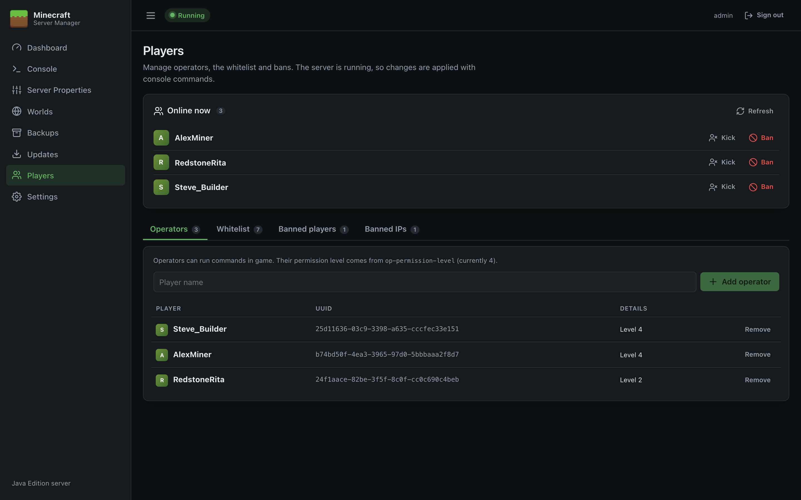
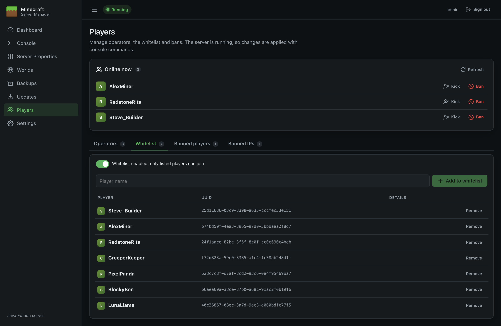
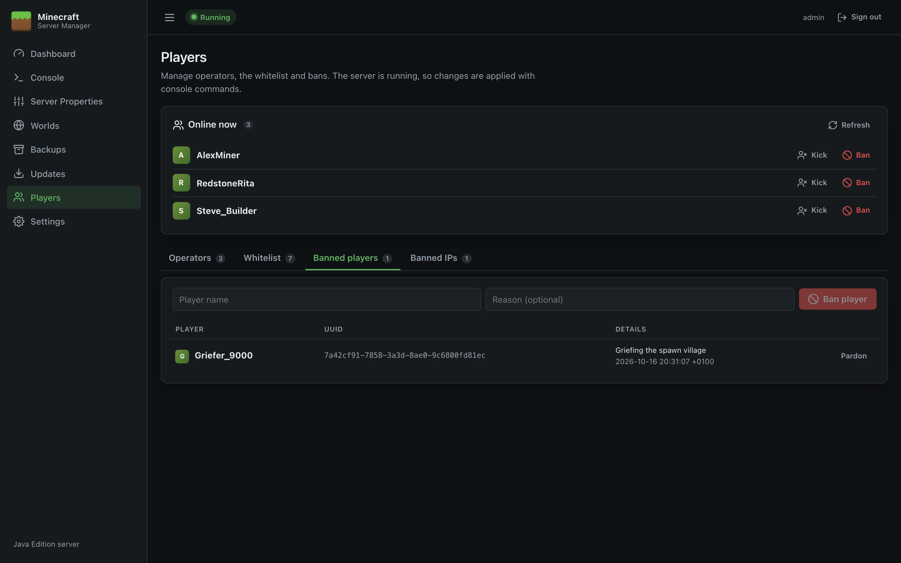
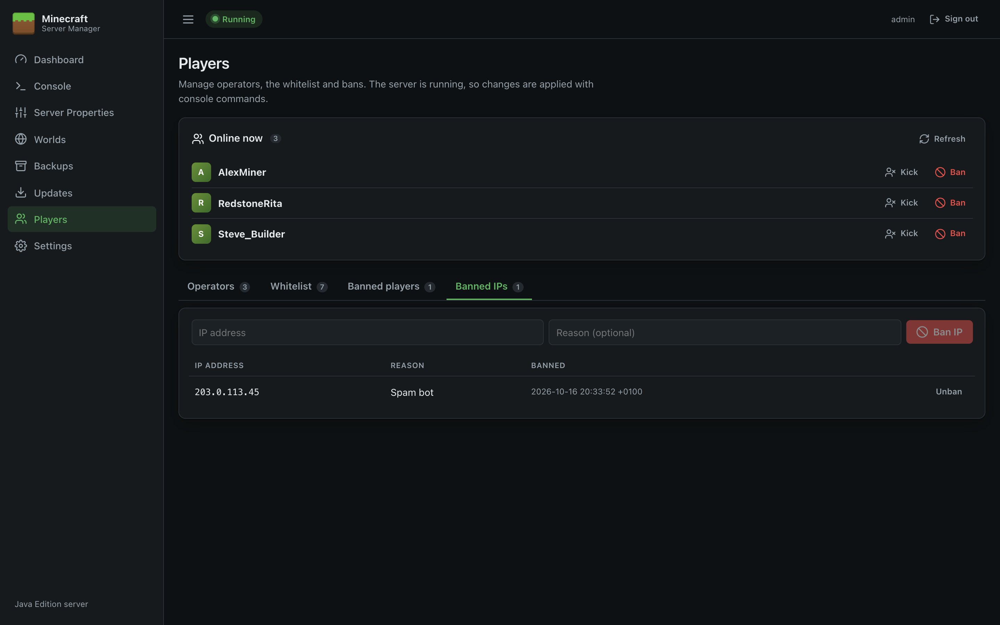

# Players

The Players page manages who's online, operators, the whitelist and bans.

## How changes are applied

- **While the server is running**, the panel sends the matching console command (`op`, `whitelist add`, `ban`, …). The change takes effect immediately and the server updates its own files.
- **While the server is stopped**, the panel edits `ops.json`, `whitelist.json`, `banned-players.json` and `banned-ips.json` directly. To get the player's unique ID it asks Mojang's account service (so the name must be a real Minecraft account), or calculates the offline ID if `online-mode` is `false`.

A line under the page title tells you which mode is in use. Player names must be 1–16 characters: letters, numbers and underscores.

## Online now

Lists everyone currently connected, with buttons to:

- **Op**: make them an operator (shown if they aren't one).
- **Kick**: disconnect them (they can rejoin).
- **Ban**: ban and disconnect them, after confirmation.

**Refresh** runs `list` to resynchronise the list with the server.

## Operators

Operators can use commands in game. Their permission level comes from `op-permission-level` in [Server Properties](Server-Properties) (4 = all commands). Enter a name and click **Add operator**; click **Remove** to take it away.

## Whitelist

When the whitelist is on, only listed players can join.

- The switch at the top turns the whitelist on or off. It updates `white-list` in `server.properties` and, if the server is running, applies it immediately with `whitelist on` / `whitelist off`.
- **Add to whitelist** and **Remove** manage the list.
- To also remove players who are already online but not on the list, turn on `enforce-whitelist` in [Server Properties](Server-Properties).

## Banned players

Enter a name and an optional **Reason** (shown to the player) and click **Ban player**. **Pardon** lifts the ban.

## Banned IPs

Bans an IP address, so nobody can join from it. Enter the address and optional reason and click **Ban IP**; **Unban** removes it.

> **Tip:** Changes made in game (for example an operator typing `/ban`) appear here too, because the page reads the same files.
