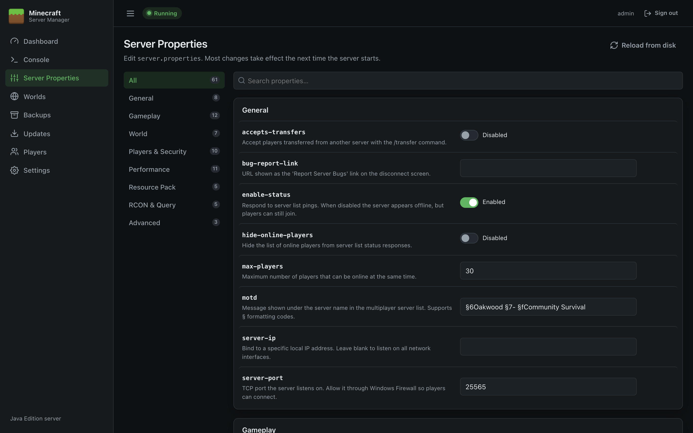
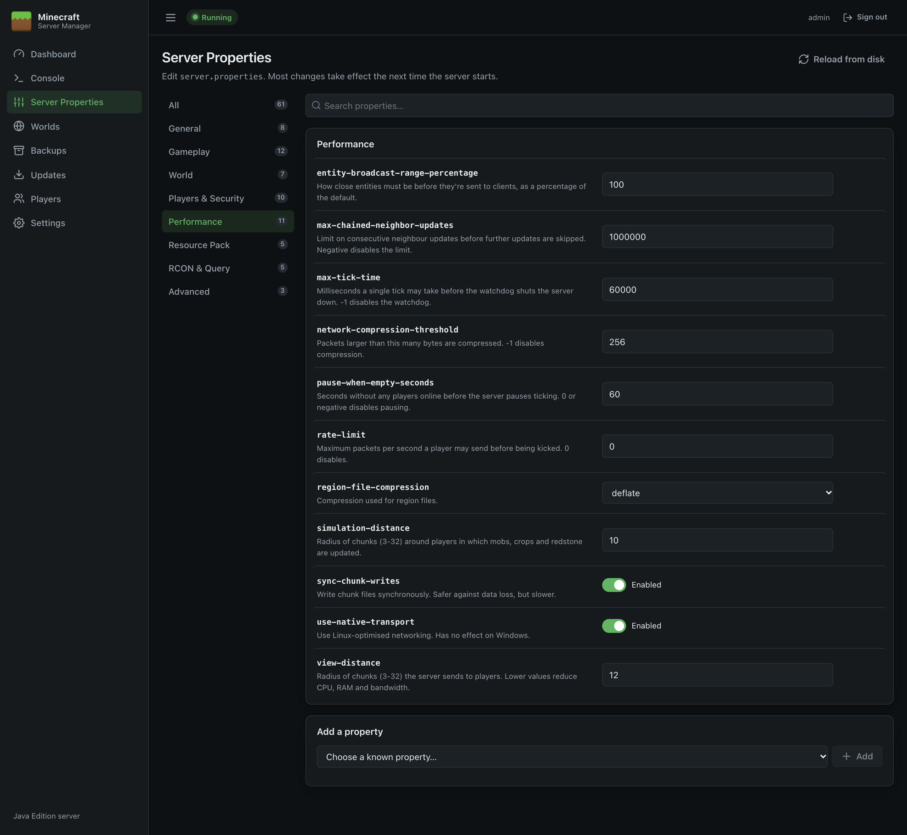
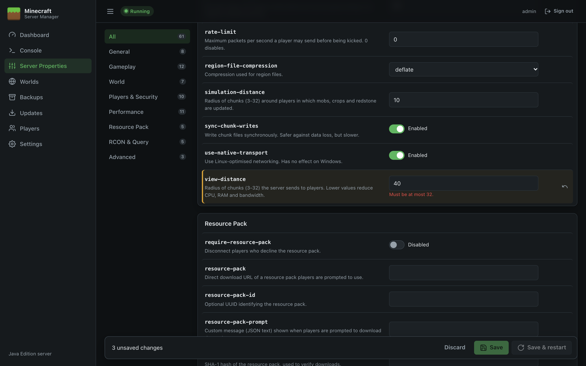

# Server Properties

This page edits `server.properties`, Minecraft's main configuration file, with proper controls instead of a text editor.

## How the page is laid out

- **Categories** on the left: *All, General, Gameplay, World, Players & Security, Performance, Resource Pack, RCON & Query, Advanced*, and *Other* for keys the panel doesn't recognise. The number shows how many settings are in each.
- **Search properties…** filters by name or description.
- Each setting shows its **key** (the name in the file), a **description**, and an input suited to its type:

| Type | Control |
| --- | --- |
| On/off | A switch showing *Enabled* or *Disabled* |
| Number | A number box with limits, e.g. `view-distance` 3–32 |
| Choice | A drop-down, e.g. `difficulty`: peaceful, easy, normal, hard |
| Text | A text box, e.g. `motd` |
| Secret | A password box with **Show**/**Hide**, e.g. `rcon.password` |
| JSON | A multi-line box, e.g. `generator-settings` |

The full list of settings, with defaults and descriptions, is in the [Server Properties Reference](Server-Properties-Reference).

## Changing settings

1. Change one or more values. Changed rows are highlighted in amber, and a bar appears at the bottom showing how many unsaved changes there are.
2. Invalid values are flagged in red (for example a number outside its range), and saving is blocked until they're fixed.
3. Use the **↶** button on a row to undo that change, or **Discard** to undo everything.
4. Click **Save**. If the server is running, you can click **Save & restart** instead to apply the changes straight away.

> **Most settings take effect the next time the server starts.** Minecraft reads `server.properties` at start-up, so after **Save** you'll see a reminder to restart.

## Adding and removing settings

- **Add a property** at the bottom lists known settings that aren't in your file. Pick one and click **Add**. Choose **Custom key…** to add any other key (for example one used by a mod).
- Settings the panel doesn't recognise, and ones you've just added, have a **🗑** button to remove them.
- **Reload from disk** re-reads the file, for example after editing it by hand.

## When the file doesn't exist yet

Before the server has run for the first time there's no `server.properties`. The page shows Minecraft's defaults instead; click **Save** to create the file with them, or just start the server and it creates one.

## Good to know

- **Switching or creating worlds:** use the [Worlds](Worlds) page rather than editing `level-name` here. It handles restarts and new-world settings for you.
- **Seeds and world type** (`level-seed`, `level-type`, `generator-settings`) only affect newly generated worlds.
- **Whitelist:** the switch on the [Players](Players) page sets `white-list` and applies it immediately on a running server.
- **Colour codes in the MOTD:** use `§` codes, e.g. `§6Gold §fWhite`. The panel saves them in the escaped form Minecraft expects (`§`).
- **Comments and order are preserved.** The panel only changes the lines you edit. Minecraft itself rewrites the file each time it starts.
- **RCON isn't needed.** The panel controls the server directly. Only enable RCON if another tool needs it, and never expose its port to the internet.
