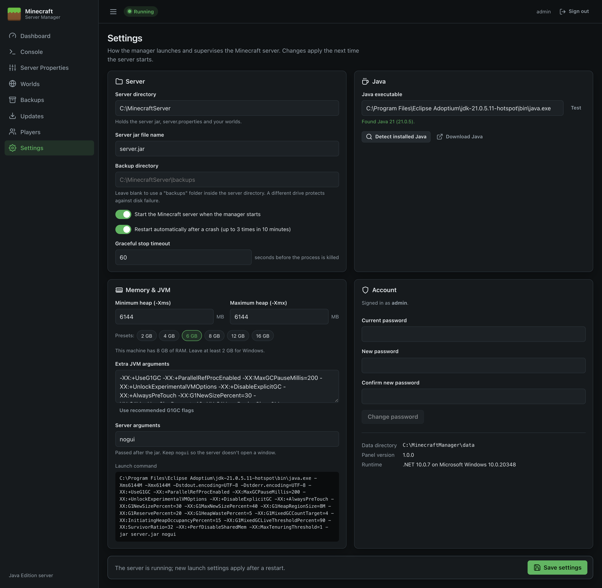

# Settings

Settings controls how the panel launches and supervises Minecraft: folders, Java, memory, automatic start and restart, and your password. Click **Save settings** at the bottom to apply changes. Launch settings take effect the next time the server starts.

## Server

| Setting | Default | Notes |
| --- | --- | --- |
| **Server directory** | `C:\MinecraftServer` | Holds the server jar, `server.properties`, `eula.txt`, the player lists and worlds. Must be a full path; it's created if missing. Changing it doesn't move files. |
| **Server jar file name** | `server.jar` | The jar to launch. Change it to run a different jar (e.g. Paper). Must end in `.jar`. |
| **Backup directory** | *(blank: `backups` inside the server directory)* | Where [Backups](Backups) are written. A different drive is recommended. |
| **Start the Minecraft server when the manager starts** | Off | Turn on to start Minecraft automatically when the panel (or Windows) starts. |
| **Restart automatically after a crash** | On | Restarts the server 10 seconds after a crash, up to 3 times in 10 minutes. After that it waits for you to start it, so a broken configuration doesn't loop forever. |
| **Graceful stop timeout** | 60 seconds | How long **Stop** waits for Minecraft to save and exit before killing the process (5–600). Increase it for very large worlds. |

## Java

| Setting | Notes |
| --- | --- |
| **Java executable** | Full path to `java.exe` (or just `java` to use the `PATH`). |
| **Test** | Runs `java -version` and shows the version found, or an error. |
| **Detect installed Java** | Searches `JAVA_HOME`, the `PATH` and standard install folders, and lists every runtime found. Click one to select it. |
| **Download Java** | Opens the Eclipse Temurin download page. |

> When the panel runs as a Windows service it uses the service account's `PATH`. Selecting a full path with **Detect** avoids "Java not found" problems.

## Memory and JVM

| Setting | Notes |
| --- | --- |
| **Minimum heap (-Xms)** / **Maximum heap (-Xmx)** | Memory given to Minecraft, in MB. The presets (2–16 GB) set the maximum. The page shows the machine's total RAM; leave at least 2 GB for Windows. A typical small server needs 4–6 GB. |
| **Extra JVM arguments** | Additional Java options. **Use recommended G1GC flags** fills in garbage-collector tuning widely used for Minecraft servers and sets the minimum heap equal to the maximum. |
| **Server arguments** | Passed to Minecraft after the jar. Keep `nogui` so no window opens. |
| **Launch command** | A live preview of the full command the panel will run. |

The panel always adds `-Dstdout.encoding=UTF-8 -Dstderr.encoding=UTF-8` so console text displays correctly.

## Account

- **Change password:** enter the current password and the new one twice (at least 8 characters). Changing it signs you out everywhere; sign in again with the new password.
- **Data directory, Panel version, Runtime:** information for troubleshooting.

## Validation

Settings won't save if:

- a folder isn't a full path (such as `C:\…`),
- the jar name isn't a plain file name ending in `.jar`,
- the maximum heap is under 512 MB or smaller than the minimum,
- the stop timeout is outside 5–600 seconds.

The error is shown at the top of the page.
