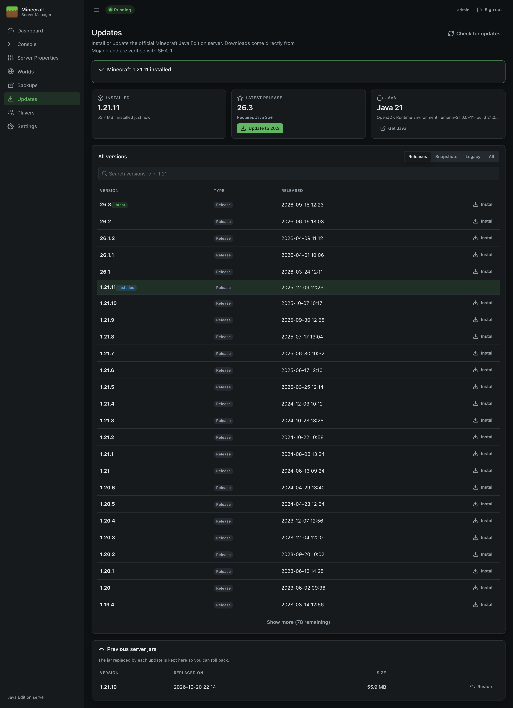
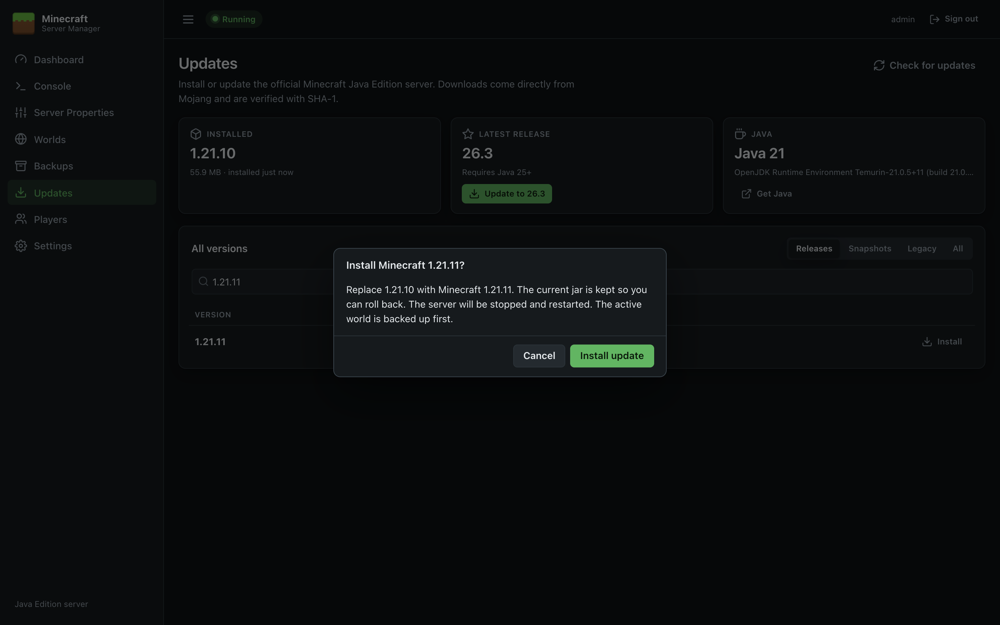
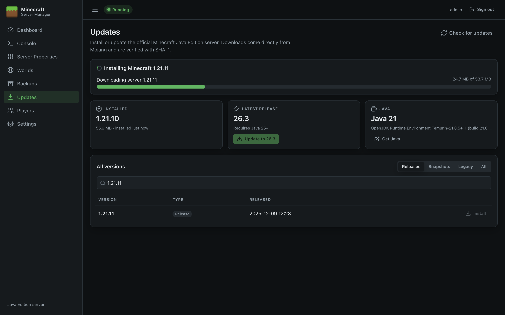
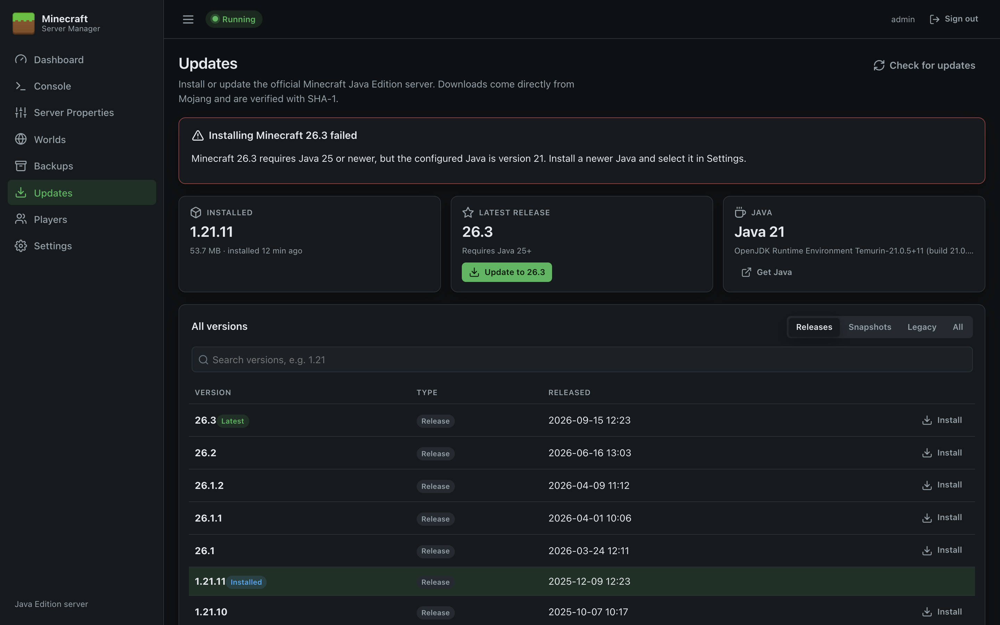

# Updates

The Updates page installs the official Minecraft Java Edition server, updates it to new versions, and rolls back if needed. Versions come from Mojang's version list, and every download is verified with SHA-1 before it's used.

## Status cards

| Card | Shows |
| --- | --- |
| **Installed** | The version of `server.jar`, read from the jar itself, with its size and install date. |
| **Latest release** | Mojang's newest release, the Java version it needs, and an **Install** / **Update to** button, or *Up to date*. |
| **Java** | The Java version the panel is configured to use (see [Settings](Settings#java)). A **Get Java** link appears if Java is missing or too old for the latest release. |

If the EULA hasn't been accepted yet, a banner with **I agree** appears at the top.

## Browsing versions

- Use **Releases**, **Snapshots**, **Legacy** (old alpha and beta versions) or **All** to filter, and the search box to find a version (e.g. `1.21`).
- The list shows 25 versions at a time; **Show more** loads more.
- The installed version is highlighted, and the newest release is marked *Latest*.
- **Check for updates** refreshes the list from Mojang (it's otherwise cached for 15 minutes).

## Installing or updating

1. Click **Install** next to a version (or the button on the *Latest release* card).
2. Read the confirmation. It tells you if the server will be restarted, if a backup will be taken, and warns about snapshots and older versions.
3. Click **Install update**.

The panel then:

1. **Checks Java.** If the configured Java is older than the version needs, it stops here and explains what to install. Nothing is changed.
2. **Downloads** the server jar from Mojang with a progress bar, and verifies its SHA-1 checksum.
3. **Backs up** the active world (if *Back up before installing server updates* is on in [Backups](Backups#scheduled-backups)).
4. **Stops** the server, if it was running.
5. **Installs** the new jar, keeping the old one for rollback.
6. **Starts** the server again, if it was running before.

The progress card stays visible for ten minutes afterwards, showing the result or any error. You can leave the page while it runs; the installation continues in the background.

> **First start after an update:** Minecraft upgrades the world to the new version the first time it loads it. This can take a while for big worlds; watch the [Console](Console).

### When Java is too old

Install the required Java (see [Installation](Installation#which-java-do-i-need)), select it in [Settings](Settings#java), and try again.

## Rolling back

Each time a jar is replaced, the old one is kept. The last **five** are listed under **Previous server jars** at the bottom of the page. Click **Restore** to switch back to one. The current jar is kept in its place, and the server is stopped and restarted if it was running.

> **Downgrading is risky.** A world opened by a newer Minecraft version may not load, or may be damaged, in an older version. The panel warns you before installing an older version. To roll back properly, restore the jar **and** the *Before update* world backup from [Backups](Backups).

## Good to know

- **Snapshots** are test versions. Use them on a copy of your world, not your main one.
- Only the vanilla (Mojang) server is installed. To run Paper, Fabric or Forge, place their jar in the server directory and set its name in [Settings](Settings#server); updates for those must be done by hand.
- The Dashboard shows a banner when a newer release than the installed one is available.
