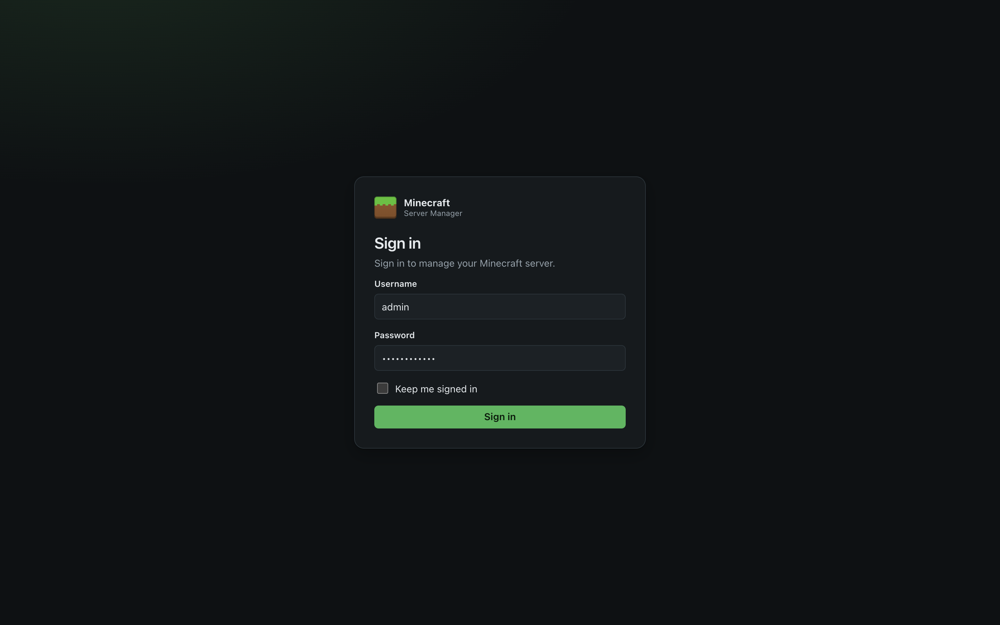
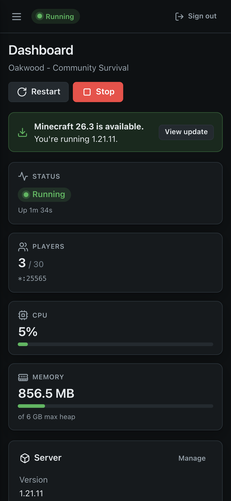
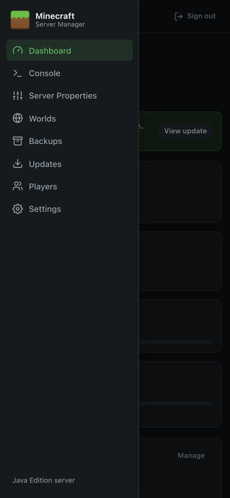
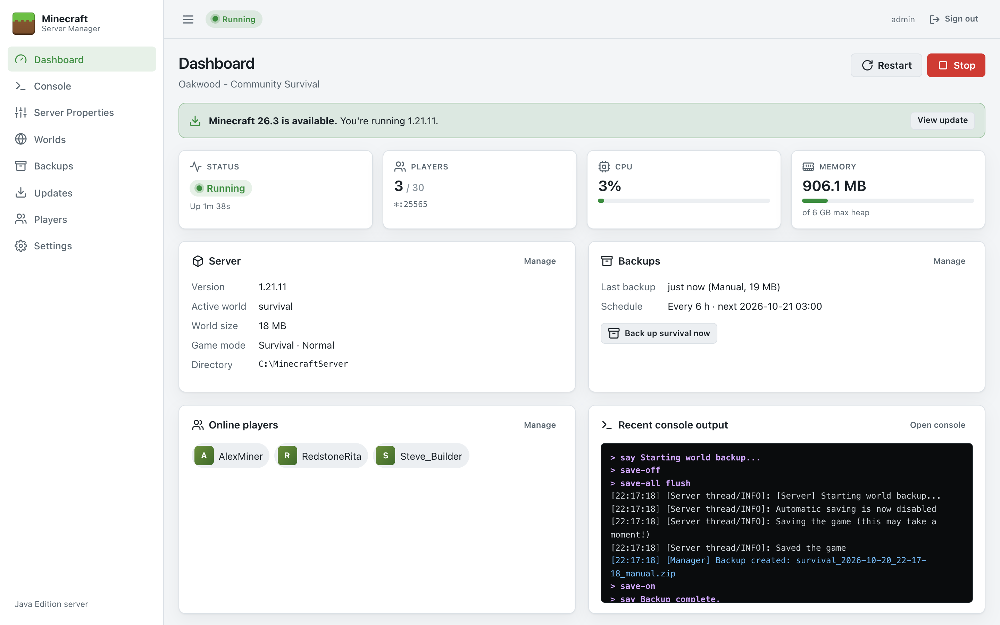

# User Guide

This guide explains how to use every part of Minecraft Server Manager day to day. It assumes the panel is installed and set up (see [Installation](Installation)).

## Signing in

Open the panel's address in a browser (by default <http://localhost:8080> on the server itself) and sign in with the administrator account created during setup.

- Tick **Keep me signed in** to stay signed in for 14 days on this browser (the period renews while you use the panel). Leave it unticked on shared computers; you'll be signed out when the browser closes.
- After **5 wrong passwords** from the same address, sign-in is blocked for **5 minutes**.
- Changing the password (in [Settings](Settings#account)) signs out every browser.

## Finding your way around

The panel has three areas:

| Area | What's there |
| --- | --- |
| **Sidebar** (left) | Links to each page: Dashboard, Console, Server Properties, Worlds, Backups, Updates, Players and Settings. |
| **Top bar** | The live **server status**, your username, and **Sign out**. |
| **Page** | The page you're on. Most pages have a title, a short explanation, and action buttons at the top right. |

### Server status

The coloured status in the top bar (and on the Dashboard) is always live:

| Status | Meaning |
| --- | --- |
| **Stopped** (grey) | No server process is running. |
| **Starting…** (amber, pulsing) | Java is running and Minecraft is loading or generating the world. Players can't join yet. |
| **Running** (green) | Minecraft reported `Done` and is accepting players. |
| **Stopping…** (amber, pulsing) | The `stop` command was sent and the world is being saved. |
| **Crashed** (red) | The server exited unexpectedly. Check the [Console](Console). If automatic restart is on it restarts itself after 10 seconds. |

### Notifications and confirmations

- Short messages pop up at the top of the page after actions. They disappear after a few seconds (errors stay a little longer), or click **×** to close them.
- Anything destructive asks for confirmation first. Deleting a world also asks you to type its name.
- Everything updates live: if another person starts the server or a backup finishes, your page updates without reloading.

### On a phone or tablet

The panel works on small screens. Tap the **☰** button at the top left to open the menu.

| Dashboard on a phone | Menu open |
| --- | --- |
|  |  |

### Light and dark appearance

The panel follows your device's light/dark setting automatically.

### If the connection drops

The panel keeps a live connection to the server. If it's interrupted (for example while the panel service restarts) a **Rejoining the server…** message appears and the page reconnects on its own. If it can't, click **Retry** or reload the page.

## Pages in this guide

| Page | Use it to |
| --- | --- |
| [Dashboard](Dashboard) | See the server at a glance and start, stop or restart it |
| [Console](Console) | Read the live log and run commands |
| [Server Properties](Server-Properties) | Change server settings such as MOTD, difficulty, whitelist and view distance |
| [Worlds](Worlds) | Create, switch, import and delete worlds |
| [Backups](Backups) | Back up, schedule, restore and download worlds |
| [Updates](Updates) | Install, update or roll back the Minecraft server |
| [Players](Players) | Manage operators, the whitelist and bans |
| [Settings](Settings) | Configure Java, memory, folders, automatic start and your password |
