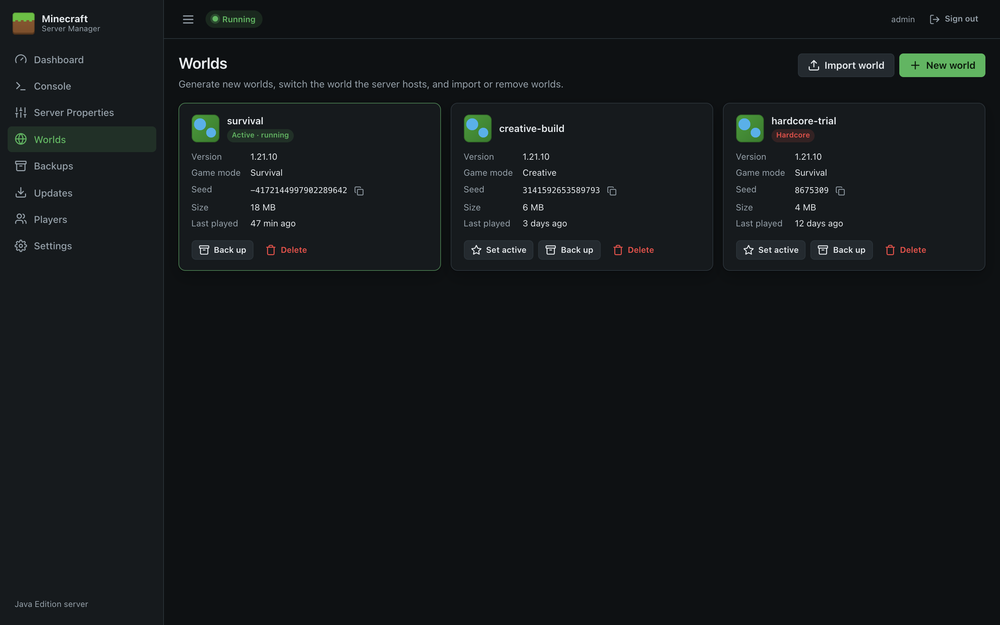
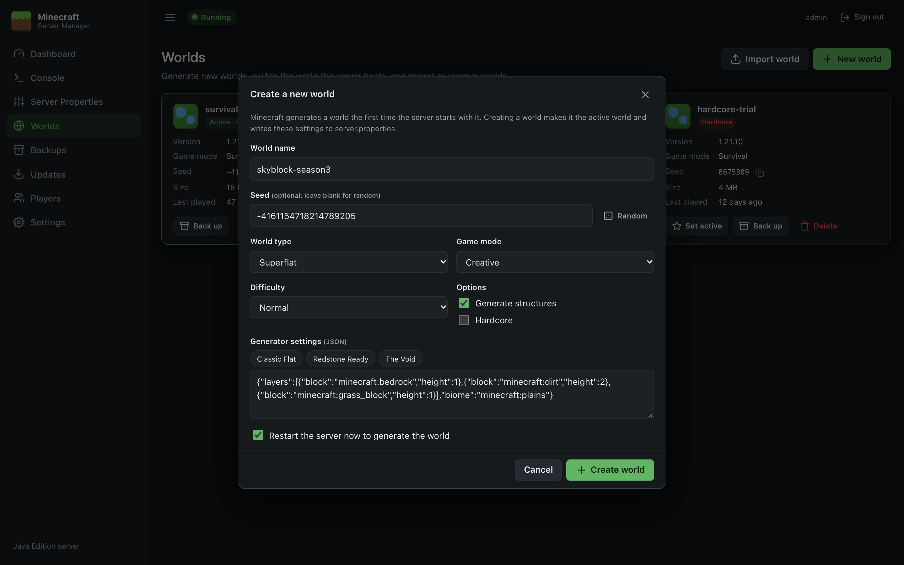
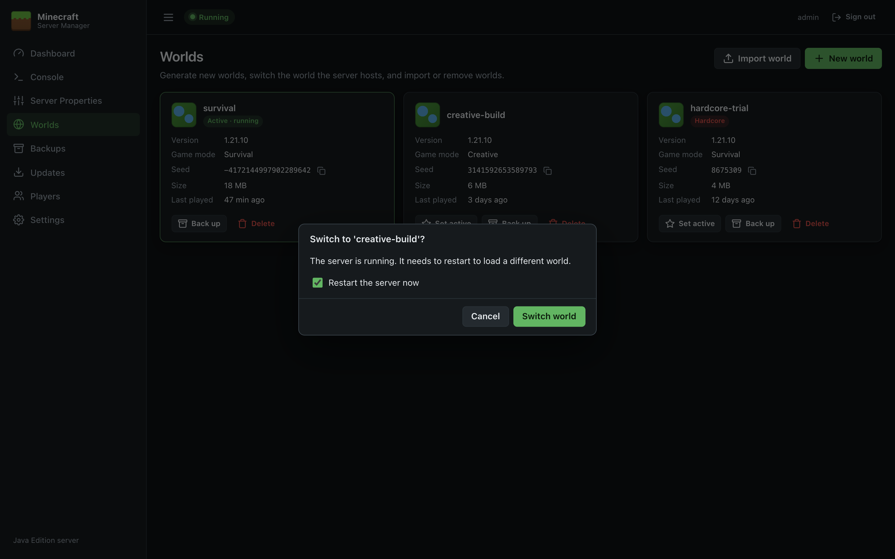
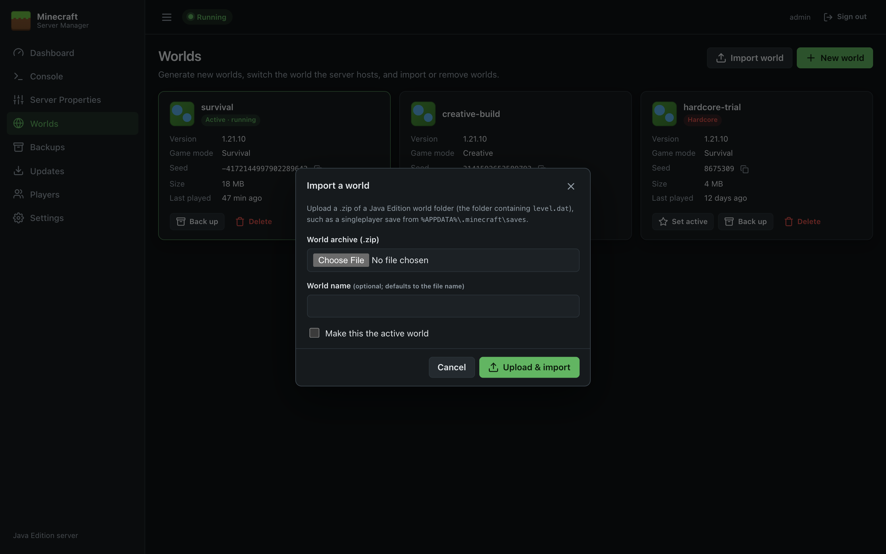
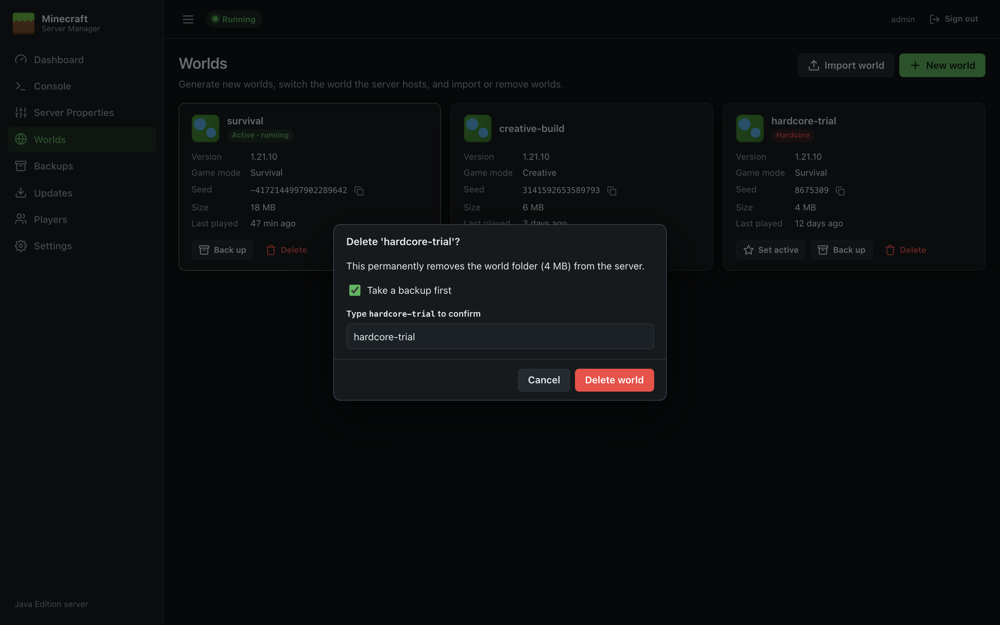

# Worlds

The Worlds page lists every world in the server directory and lets you generate new worlds, choose which world the server runs, import existing worlds and delete old ones.

## World cards

Each world is shown as a card:

| Item | Meaning |
| --- | --- |
| **Name** | The world's folder name in the server directory. |
| **Active** badge | The world the server loads (`level-name`). Shows **· running** while the server is up. |
| **Hardcore** badge | The world was created in hardcore mode. |
| **Version** | The Minecraft version that last saved the world. |
| **Game mode** | The world's default game mode. |
| **Seed** | The world seed. Click the copy icon to copy it. |
| **Size** | Space used on disk, including `world_nether` / `world_the_end` folders if the world uses that layout (Paper/Spigot style). |
| **Last played** | When the world was last saved by the server. |

Buttons on each card:

- **Set active**: make this the world the server runs (not shown on the active world).
- **Back up**: take an immediate backup of this world (see [Backups](Backups)).
- **Delete**: remove the world (see [Deleting a world](#deleting-a-world)).

If the active world hasn't been generated yet, a banner says so, with a **Start & generate** button.

## Creating a new world

Minecraft generates a world the first time the server starts with a new world name. The panel therefore writes the new world's settings to `server.properties`, makes it the active world, and (optionally) restarts the server so it's generated straight away.

1. Click **New world**.
2. Fill in the form:

   | Field | Notes |
   | --- | --- |
   | **World name** | Becomes the folder name. Letters, numbers, spaces, `-`, `_` and `.` only, up to 64 characters, and it must not already exist. |
   | **Seed** | Optional. Leave blank for a random seed, type any number or text, or click **Random** to generate one now (so you can note it). |
   | **World type** | *Default*, *Large Biomes*, *Amplified*, *Superflat* or *Single Biome*. |
   | **Game mode** | Default game mode for new players. |
   | **Difficulty** | Locked to *Hard* when Hardcore is ticked. |
   | **Generate structures** | Villages, temples, strongholds and so on. |
   | **Hardcore** | Players become spectators when they die. |
   | **Generator settings** | Shown for *Superflat* and *Single Biome*: JSON describing the layers or biome. For Superflat, the **Classic Flat**, **Redstone Ready** and **The Void** buttons fill in a preset. |
   | **Restart/Start the server now** | Ticked by default. Untick to configure the world now and generate it at the next start. |

3. Click **Create world**. Watch the generation on the [Console](Console); the server shows **Running** when it's done.

> **Note:** *Difficulty*, *Game mode* and *Hardcore* are server-wide settings in `server.properties`, so they also apply when you switch back to another world. Adjust them on [Server Properties](Server-Properties) if needed.

## Switching the active world

Click **Set active** on a world. If the server is running you'll be asked whether to restart it now (ticked by default). If you don't restart, the server keeps running the current world and loads the new one at the next start.

## Importing a world

You can upload an existing Java Edition world, such as a singleplayer save from `%APPDATA%\.minecraft\saves`.

1. Zip the world folder (the folder that contains `level.dat`). Right-click it and choose **Send to → Compressed (zipped) folder**.
2. Click **Import world**, choose the `.zip`, and optionally:
   - enter a **World name** (otherwise the zip's file name is used), and
   - tick **Make this the active world**.
3. Click **Upload & import**.

The panel finds the folder containing `level.dat` anywhere in the zip, so it doesn't matter whether you zipped the folder or its contents. Uploads of up to 8 GB are accepted. Archives containing unsafe paths are rejected. If you made the imported world active while the server was running, restart the server to load it.

> **Bedrock Edition** worlds (`.mcworld`) are a different format and can't be imported.

## Deleting a world

1. Click **Delete** on the world's card.
2. Leave **Take a backup first** ticked unless you're sure. The backup is kept on the [Backups](Backups) page as *Before delete*.
3. Type the world's name to confirm, then click **Delete world**.

You can't delete the world the server is currently running; stop the server first.
